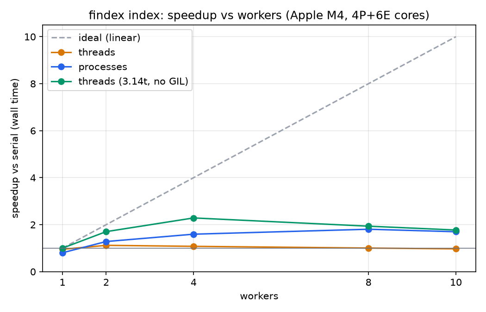

# findex

[](https://github.com/batpepe/findex/actions/workflows/ci.yml)

A full-text search engine over the **Python documentation and every PEP**, built from scratch in Python
over the eight labs of the *Python — Build a Search Engine* course. Each lab adds one language feature
and one piece of the engine; every lab is tagged (`lab-01`, `lab-02`, …) so the history shows it growing.

| Lab | Feature | What it added | Tag |
|---|---|---|---|
| 1 | Iterators & generators | streaming corpus, tokenizer, stats in constant memory | `lab-01` |
| 2 | Dicts, hashing, memory | inverted index, Boolean search, two on-disk formats | `lab-02` |
| 3 | The data model, decorators | `Index` object, BM25/TF-IDF, query language, snippets, precision@5 | `lab-03` |
| 4 | Typing, testing, packaging | `findex` CLI (typer + rich), pyright strict, 77 tests, CI, v0.4.0 wheel | `lab-04` |
| 5 | Concurrency and the GIL | parallel indexing: serial / threads / processes / free-threaded, benchmarked | `lab-05` |
| 6 | asyncio | a polite async crawler (robots.txt, per-host limits, retries) that feeds the corpus | `lab-06` |
| 7 | FastAPI, Pydantic, Docker | search API + web UI, containerized, load-tested | `lab-07` |

## Quick start

```bash
# install the command (Python 3.14+); or from a clone: uv tool install .
uv tool install https://github.com/batpepe/findex/releases/download/v0.4.0/findex-0.4.0-py3-none-any.whl

git clone https://github.com/batpepe/findex && cd findex
./scripts/get-corpus.sh                      # ~31 MB into data/ (git-ignored)
findex index data/ --out index.bin           # positions + texts, binary format
findex search index.bin '"event loop" NOT asyncio'
findex search index.bin 'TaskGroup' --json | jq .title
findex stats index.bin
```

Development: `uv sync`, then `uv run pytest`, `uv run ruff check .`, `uv run pyright`.
The lab-by-lab entry points still work: `uv run python -m findex.stats data/`, `python -m findex.index`,
`python -m findex.search`.

## The corpus

| Source | Where it comes from | Documents | Size on disk |
|---|---|---|---|
| Python 3.15 documentation, plain-text build | [docs.python.org/3/download.html](https://docs.python.org/3/download.html) (`python-3.15-docs-text.zip`) | 552 | 16 MB |
| All PEPs (reStructuredText sources) | [github.com/python/peps](https://github.com/python/peps), `peps/pep-*.rst` (public domain / CC0) | 745 | 15 MB |
| Packaging guide, pip, devguide, typing docs (Lab 6) | crawled by `findex crawl` into `data/crawl/python-sites.jsonl` | 267 | 2.5 MB |
| **Total** | `./scripts/get-corpus.sh` + the crawl command below | **1,564** | **34 MB** |

One file is one document. The corpus lives in `data/`, which is in `.gitignore`: corpora don't go into git,
the script that fetches them does. Why this corpus: it is the reference I actually search while learning
Python, it is large and varied enough (from a 97-byte deprecation note to the 2.4 MB changelog), and its
licences allow crawling and redistributing (Lab 6 crawls more of it).

---

## Lab 1 — Streams, not lists

**Built:** `findex.corpus.iter_documents` (lazy, sorted, one file open at a time; `.txt`/`.rst`/`.md` trees
and JSON-lines, also `.jsonl.gz`; undecodable bytes are logged and replaced instead of crashing the run),
`findex.tokenize.tokenize` (a generator over `re.finditer`), and `python -m findex.stats` — the
`iter_documents → tokenize → Counter` pipeline with `--limit N` implemented with `itertools.islice`.

Both stages are generators (`inspect.isgeneratorfunction` is asserted in `tests/test_tokenize.py`), and
`next(iter_documents(Path("data")))` returns the first document (`PEP 1 – PEP Purpose and Guidelines`) in
**0.6 ms** — before the other 1,296 files are even opened.

### Tokenizer policy

1. **Unicode:** NFC → `casefold()` → NFC again (case folding can decompose). `casefold` rather than `lower`:
   `"Straße".casefold() == "strasse"`. NFC because `"café"` and `"café"` look identical but are
   different strings. Typographic and Ukrainian apostrophes (`’` U+2019, `ʼ` U+02BC, `‘`, `＇`) become `'`.
2. **Token** = a run of Unicode word characters (`\w` — letters and digits of any script, and `_`) plus
   combining marks.
3. **Apostrophes** stay *inside* words (`don't`, `п'ять`), never at the edges (`'quoted'` → `quoted`);
   the English possessive `'s` is dropped (`Python's` → `python`).
4. **Hyphens split** (`free-threaded` → `free`, `threaded`), so a search for `threaded` finds it; phrase
   search (Lab 3) gets the compound back.
5. **Digits** are tokens; `3.15` → `3`, `15`; mixed alphanumerics stay whole (`utf8`, `py3`).
6. **Underscores** are word characters, so identifiers survive (`__init__`, `snake_case`); a token of only
   underscores is dropped.
7. **No stop words, no stemming:** IDF will down-weight `the` by itself, and phrases need every word.

All seven rules are pinned by tests (mixed case, Cyrillic, a combining accent, punctuation, empty input,
apostrophes, hyphens, digits, identifiers): `uv run pytest`.

### Corpus statistics

```text
$ uv run python -m findex.stats data/
mode:        lazy (generators)
documents:   1,297
tokens:      4,152,788
vocabulary:  78,218
elapsed:     3.09 s
peak memory: 41.2 MiB (tracemalloc)
retained:    5.6 MiB (still allocated at the end: the term table)
max RSS:     79.4 MiB (whole process, incl. interpreter)

top 50 terms:
   1. the         219,940
   2. to           97,279
   3. a            95,684
  ...
  12. python       33,934
  ...
  27. pep          14,765
  ...
  35. bpo          12,178
```

The top of the list is English function words, as Zipf predicts; the first content words are `python`,
`pep`, `type`, `module`. `bpo` (the old bugs.python.org issue prefix) is in the top 35 purely because of
the 2.4 MB changelog — the first hint that document length will matter for ranking (Lab 3, BM25).

### Eager vs lazy

The eager version (`--eager`) reads every document into a list, tokenizes each into a list, then counts.
Same tokenizer, same output; each row is the median of 3 runs in a fresh process
(`uv run python scripts/bench_stats.py data/`, Apple M4, Python 3.14):

| Version | Documents | Tokens | Peak memory (tracemalloc) | Max RSS | Elapsed |
|---|---|---|---|---|---|
| eager (lists) | 400 | 991,030 | 58.3 MiB | 160.3 MiB | 0.68 s |
| lazy (generators) | 400 | 991,030 | 3.1 MiB | 29.5 MiB | 0.69 s |
| eager (lists) | 800 | 2,214,105 | 132.1 MiB | 329.5 MiB | 1.63 s |
| lazy (generators) | 800 | 2,214,105 | 7.4 MiB | 34.7 MiB | 1.62 s |
| eager (lists) | 1,297 | 4,152,788 | 261.6 MiB | 629.0 MiB | 3.20 s |
| lazy (generators) | 1,297 | 4,152,788 | 41.2 MiB | 79.4 MiB | 3.22 s |

**Where the memory went.** The eager peak grows linearly with the corpus because everything is alive at
once. On the full corpus I accounted for it object by object: the 4,152,788 token strings are separate
`str` objects of ~46 bytes each (a 40-byte header for a 4–5 character word) = **182.5 MiB**; the 1,297
token lists hold an 8-byte pointer per token = **33.7 MiB**; the document texts themselves = **40.6 MiB**.
That is 256.8 of the 261.6 MiB peak; the rest is the `Counter` and the document tuples. The text is the
*smallest* part: tokenizing a 31 MB corpus into Python objects costs 6× the corpus. The lazy pipeline
holds one document and the `Counter` (5.6 MiB retained at the end: 78,218 terms). Its peak is not that
small on the full corpus because one document is huge: `whatsnew/changelog.txt` is 2.4 MB of text,
stored as a 2-byte-per-character string (one `→` forces UCS-2), so 4.7 MB per copy; normalization makes
several transient copies (NFC, casefold, apostrophe translation, NFC again) while it is the current
document. Without it (`--limit 1295` stops just before the changelog) the lazy peak is **7.6 MiB** for
1,295 documents — memory is *one document + the term table*, not the corpus. (The changelog alone also
adds 14,332 terms to the vocabulary: issue numbers and contributor names.) Time is identical: both versions do the same CPU work (regex + casefold), the
lazy one just never keeps what it has finished with. Max RSS is higher than tracemalloc's peak in both
columns because it includes the interpreter, tracemalloc's own bookkeeping, and freed memory the
allocator has not returned to the OS.

**What I learned.** A generator is a paused function, not a container: the pipeline never "has" the
corpus, it has the next document. The only structure allowed to grow is the sink that holds the answer.
And Python objects are expensive — a 4-letter word costs 46 bytes as a `str` plus 8 for the pointer to
it — which is exactly the problem Lab 2 has to solve for the inverted index.

---

## Lab 2 — The inverted index

**Built:** `findex.index` — `Posting(doc_id, tf, positions)` and `DocMeta(path, title)` are
`@dataclass(frozen=True, slots=True)` (hashable value objects: the tests put them in a set and check
there is no `__dict__`); `build_index` makes **one streaming pass**: each document's terms are counted
in a local `Counter` (or collected as position lists with `--positions`) and *flushed* into a
`defaultdict(list)` when the document ends. Documents arrive in increasing `doc_id` order, so every
postings list is born sorted. `findex.search` evaluates `a b` (AND), `OR`, `NOT` left to right with
**two-pointer merges**, or with Python sets (`--engine set`). `findex.store` saves and loads two formats.

```text
$ uv run python -m findex.index data/ --out index.bin
documents:   1,297
terms:       78,218
postings:    861,841
positions:   no
build:       3.82 s
save:        1.02 s (binary, 8.6 MiB)
peak memory: 97.5 MiB (tracemalloc)

$ uv run python -m findex.search index.bin "asyncio TaskGroup" --limit 4
13 matching documents for 'asyncio TaskGroup' (merge engine)
  [  472] PEP 654 – Exception Groups and except*  (peps/pep-0654.rst)
  [  601] PEP 785 – New methods for easier handling of ExceptionGroups  (peps/pep-0785.rst)
  [  605] PEP 789 – Preventing task-cancellation bugs by limiting yield in async generators  (peps/pep-0789.rst)
  [  917] High-level API Index  (pydocs/library/asyncio-api-index.txt)
  ... and 9 more
load:        107.1 ms
search:      0.18 ms
peak memory: 24.7 MiB (tracemalloc)
```

### Merge vs sets

`uv run python scripts/bench_merge.py index.bin` — best of 5 × 2,000 calls, on the two most common terms
(`the` is in 1,295 of 1,297 documents), the two rarest (document frequency 1), and one of each:

| Operands | len(a), len(b) | Op | merge (µs) | set (µs) | faster |
|---|---|---|---|---|---|
| common AND common (`the`, `in`) | 1295, 1279 | AND | 58.67 | 31.43 | set 1.9× |
| common AND common (`the`, `in`) | 1295, 1279 | OR | 58.88 | 29.30 | set 2.0× |
| common AND common (`the`, `in`) | 1295, 1279 | NOT | 56.12 | 24.92 | set 2.3× |
| rare AND rare (`aaaaa`, `aaaaaa`) | 1, 1 | AND | 0.08 | 0.13 | merge 1.6× |
| rare AND rare (`aaaaa`, `aaaaaa`) | 1, 1 | OR | 0.16 | 0.14 | set 1.1× |
| rare AND rare (`aaaaa`, `aaaaaa`) | 1, 1 | NOT | 0.10 | 0.14 | merge 1.4× |
| rare AND common (`aaaaa`, `the`) | 1, 1295 | AND | 50.72 | 4.24 | set 12.0× |
| rare AND common (`aaaaa`, `the`) | 1, 1295 | OR | 57.51 | 14.72 | set 3.9× |
| rare AND common (`aaaaa`, `the`) | 1, 1295 | NOT | 44.15 | 4.21 | set 10.5× |

Both are O(n + m), but the merge's n + m steps are **Python bytecode** (a compare, an index, an
increment — tens of nanoseconds each) while `set(a) & set(b)` hashes in **C**. So sets win on long lists
by ~2×, and by 10× when one list is tiny: the merge still walks all 1,295 entries of `the` to find one
document. The merge wins only when both lists are tiny (no set to build). What the merge buys is not
speed in CPython but shape: it streams, needs no extra memory, works on compressed or memory-mapped
postings, and is the same algorithm phrase search uses on positions (Lab 3). The obvious next step for
rare-AND-common — galloping through the long list with `bisect` (C) instead of stepping — is noted for
Lab 8.

### Two formats on disk

`findex.store` writes **pickle** or a **binary** format (default): a JSON header with the documents and
`term → (byte offset, df, total tf)`, then every postings list as raw `uint32` arrays (`doc_ids`, `tfs`,
then positions if present). Loading the binary file `mmap`s it and parses only the header; a term's
postings are decoded from the mapped bytes the first time a query asks for them. Terms are written in
sorted order, so the same index always produces the same bytes (a test checks it).
`uv run python scripts/bench_store.py data/`:

| Positions | Format | File size | Save | Load (median of 5) | Load + first query |
|---|---|---|---|---|---|
| no | pickle | 14.3 MiB | 1.81 s | 2013 ms | 2025 ms |
| no | binary | 8.6 MiB | 0.58 s | 25 ms | 25 ms |
| yes | pickle | 27.4 MiB | 2.32 s | 2546 ms | 2525 ms |
| yes | binary | 24.5 MiB | 0.56 s | 28 ms | 27 ms |

The binary file loads **80× faster** because it does not create 861,841 objects up front; it decodes only
the postings a query touches. **Positions** cost 2.85× the file size (24.5 vs 8.6 MiB: one 4-byte int
per token occurrence, 4.15 M of them, against two per posting), +44% build time (5.5 vs 3.8 s), and 2.9× the
build peak (280 vs 97.5 MiB — a tuple object per posting). They stay optional (`--positions`) until
phrase search needs them in Lab 3.

**Why pickle is dangerous.** `pickle.load` is not a parser, it is a small virtual machine: a pickle can
tell it to import any callable (`os.system`, `subprocess.Popen`) and call it with arguments — that is how
`__reduce__` works. Loading a downloaded index file is therefore remote code execution. `findex` only
unpickles files it wrote itself (`store.load_pickle` says so in a comment), and the binary format, which
can only ever produce numbers and strings, is the default.

### The memory study

The same postings in three representations, each built in a fresh process under tracemalloc
(`uv run python scripts/bench_memory.py data/`):

| Postings representation | Peak memory (build) | Held by postings | Bytes / posting | Pickle file size | Pickle load time |
|---|---|---|---|---|---|
| `list[Posting]`, plain `@dataclass` | 128.6 MiB | 97.2 MiB | 118.3 | 19.1 MiB | 291 ms |
| `list[Posting]`, `slots=True` | 96.9 MiB | 64.3 MiB | 78.3 | 14.2 MiB | 2012 ms |
| `array('I')` pairs (doc_ids, tfs) | 62.6 MiB | 30.7 MiB | 37.3 | 10.0 MiB | 47 ms |

**Where the bytes went.** All three rows share 5.6 MiB (6.8 bytes per posting) for the 78,218 term
strings (3.7 MiB) and the dict table that maps them (1.8 MiB). On top of that, per posting: a **plain**
dataclass instance is **96 bytes** (measured: a 48-byte object plus 48 bytes of instance-attribute
storage — its `__dict__`), plus an 8-byte pointer in the list and ~7 bytes of list headers and
over-allocation; **`slots=True`** removes the attribute storage and puts the three fields in fixed
slots — **56 bytes** (16-byte header, 3 × 8-byte field pointers, GC links) — exactly the 40-byte
difference between rows 1 and 2. The **arrays** store `doc_id` and `tf` as raw 4-byte integers — **8
bytes per posting, no objects** — and the remaining ~22 bytes per posting in that row are per-*term*
overhead: two 80-byte `array` headers and a 64-byte tuple for each of the 78,218 terms, plus
over-allocated buffers. Most terms occur in a single document, so that overhead is never amortized.
The ints themselves cost nothing extra in the object rows: small ints are cached and each document's
`doc_id` object is shared by all its postings.

The surprise is the last column: the slotted class is smaller **and 7× slower to unpickle**. A frozen
dataclass with slots cannot be restored by filling a `__dict__`, so `dataclasses` generates a Python-level
`__setstate__` (`_dataclass_setstate`), called once per object — 861,841 Python function calls. The plain
class is restored by a C-level `__dict__` update, and arrays are pickled as one raw byte buffer each.
Fewer objects beats smaller objects; no objects beats both — which is why the binary format stores
arrays and why Lab 8 turns them into NumPy.

**What I learned.** A Python object is never "just its fields": the header, the attribute dict, the
pointer to it and the GC links are paid per instance, and at 861,841 instances they dominate. `slots`
fixes the dict, arrays fix the objects. And the hashing contract is what makes `frozen=True` the safe
way to get value objects that can live in sets and as keys.

---

## Lab 3 — Ranking and the object model

**Built:**

- **`Index`** (`findex.index`) is a read-only `collections.abc.Mapping[str, list[Posting]]`: implementing
  `__getitem__`, `__iter__` and `__len__` gives `in`, `.get`, `.keys/.items`, `==` for free, and
  `__contains__` is overridden only because a direct dict lookup beats `Mapping`'s try/except.
  `repr(index)` is `Index(terms=78_218, docs=1_297, positions=True)`; `num_docs` is a property,
  `avg_doc_length` a `cached_property` (BM25 needs it for every posting: computed once per index, not once
  per posting); `df()`, `doc_length()`, `title()`, `text()`. `with open_index(path) as ix:` (a
  `@contextmanager`) releases the memory map even when the body raises — a test raises inside it and
  checks the map is gone. The binary index now also stores every document's text, zlib-compressed (31 MB
  of text → 9.4 MB), so snippets need no corpus on disk.
- **Scoring** (`findex.rank`): a `Scorer` `typing.Protocol` (`score(term, posting, index) -> float`) and
  two independent implementations, `TfIdf` and `BM25(k1=1.5, b=0.75)` — frozen dataclasses with
  `__call__`, so they are hashable (they are part of the cache key) and usable as functions. No base class.
  `Searcher.search(query, scorer, k)` accumulates per-document scores in a `defaultdict(float)` and keeps
  the top `k` with `heapq.nlargest` — O(n log k) instead of sorting every match. Results are
  `SearchResult` dataclasses with `order=True` whose first field is `score`, so `sorted(results)` ranks
  them; `ResultList` is a `Sequence` whose slices stay `ResultList`s and keep `total`.
- **The query language** (`findex.query`): a recursive-descent parser (`or_expr → and_expr → not_expr →
  atom`) building `Term`, `Phrase`, `And`, `Or`, `Not` nodes — frozen dataclasses, so tests compare
  **trees**: `parse("a OR b c") == Or(Term("a"), And(Term("b"), Term("c")))`. Nodes overload `&`, `|`,
  `~` (`Term("a") & ~Term("b")`), and each has `evaluate(index) -> frozenset[int]`. Phrases are checked
  with Lab 2's two-pointer `intersect` on positions shifted by their offset in the phrase; a hyphenated
  word (`free-threaded`) becomes a phrase automatically — the tokenizer split it, positions glue it back.
  Bad syntax raises `QueryError` with the offset (`missing ')' for '(' at offset 0`).
- **Decorators and caching:** `@timed` (with `functools.wraps`) logs `build_index`, `load` and
  `Searcher.search` at DEBUG; the query → ranked-ids step and the snippets are `functools.lru_cache`d
  *per `Searcher` instance* (a cache on the method itself would be shared by every instance and keep
  every index alive). `explain()` is a `functools.singledispatch` function with one implementation per
  node type, and `--explain` prints each result's score term by term, like Elasticsearch's `_explain`.
- **Snippets** (`findex.snippets`): re-tokenize the stored text with offsets (`token_spans`, the same
  tokens as `tokenize`, but on text that is NFC-normalized and *not* case-folded, so offsets stay valid
  for display), slide a ±80-character window over the hits and keep the one covering the most distinct
  query terms, then highlight (`**term**` in the terminal, `<mark>` for HTML later).

```text
$ uv run python -m findex.search index.bin '"event loop" NOT asyncio' -k 3 --explain
9 matching documents for '"event loop" NOT asyncio' (bm25, top 3)
parsed as: ("event loop" AND NOT asyncio)
  1.   6.500  Tkinter dialogs  (pydocs/library/dialog.txt)
         … Render dialog and start **event** **loop**. ok_event(**event**) Exit dialog returning current selection.  …
           event            tf=17    df=216   ->  4.262
           loop             tf=1     df=245   ->  2.238
           doc length 1,380 tokens (average 3,202)
  2.   6.127  tkinter — Python interface to Tcl/Tk  (pydocs/library/tkinter.txt)
         … like "grid" controls where in the user interface they are placed. **event** **loop** Tkinter reacts to user input, …
           event            tf=82    df=216   ->  3.899
           loop             tf=14    df=245   ->  2.228
           doc length 33,536 tokens (average 3,202)
  ...
```

The cache hit, from the timing log (`--repeat 2 -v`):

```text
DEBUG findex.rank: ranked 'unicode normalization': 17 matches, top 2
DEBUG findex.rank: query cache: CacheInfo(hits=0, misses=1, maxsize=256, currsize=1)
DEBUG findex.rank: Searcher.search took 8.27 ms
DEBUG findex.rank: query cache: CacheInfo(hits=1, misses=1, maxsize=256, currsize=1)
DEBUG findex.rank: Searcher.search took 0.06 ms
```

### The three sanity checks, on this corpus

`uv run python scripts/sanity_ranking.py index.bin` (all three are also unit tests in `tests/test_rank.py`):

1. **A rare term outranks a common one.** `python OR walrus`: `python` is in 1,207 of 1,297 documents,
   `walrus` in 16. All four top results contain `walrus` (PEP 622, 3136, 635, 634); IDF makes `python`
   almost worthless.
2. **BM25 saturates term frequency.** The BM25 contribution of `walrus` in an average-length document:

   | tf | 1 | 2 | 3 | 5 | 10 | 19 | 20 | 21 |
   |---|---|---|---|---|---|---|---|---|
   | BM25 | 4.366 | 6.237 | 7.276 | 8.395 | 9.490 | 10.115 | 10.152 | 10.186 |
   | TF-IDF | 4.395 | 7.442 | 9.224 | 11.469 | 14.516 | 17.337 | 17.562 | 17.777 |

   The 2nd occurrence adds +1.87; the 21st adds +0.034 — 55× less, bounded by `idf · (k1 + 1)`. TF-IDF's
   `1 + ln tf` grows forever (+0.21 for the 21st).
3. **A short document with one match beats a long one with one match.** The term `mmdf` occurs exactly
   once in *Internet Data Handling* (228 tokens) and once in the *Changelog* (342,806 tokens): BM25 gives
   **9.732 vs 0.116**; TF-IDF gives both **5.782** — it cannot tell them apart.

### Evaluation: precision@5

Ten queries I know the answers to, with relevance labelled by hand in `eval/queries.json` (relevant =
the document is primarily *about* the topic; the changelog and the table of contents are never relevant;
I pooled the top 10 of both scorers and added known documents missing from the pool).
`uv run python scripts/evaluate.py index.bin`:

| Query | relevant | BM25 P@5 | TF-IDF P@5 |
|---|---|---|---|
| `global interpreter lock` | 7 | 0.6 | 0.4 |
| `structural pattern matching` | 7 | 1.0 | 1.0 |
| `generic type hints` | 10 | 0.8 | 0.4 |
| `virtual environment` | 7 | 1.0 | 0.8 |
| `f-string formatting` | 4 | 0.2 | 0.2 |
| `async generator` | 4 | 0.6 | 0.4 |
| `dataclass frozen slots` | 3 | 0.4 | 0.4 |
| `context manager with statement` | 6 | 0.8 | 0.6 |
| `unicode normalization` | 5 | 0.8 | 0.6 |
| `reference counting garbage collection` | 8 | 1.0 | 0.8 |
| **mean** | | **0.72** | **0.56** |

BM25 wins or ties on every query. The main TF-IDF failure is visible in the pools: the 342,806-token
changelog is TF-IDF's **#1 result for 7 of the 10 queries** — it mentions everything, and nothing in
TF-IDF penalizes length. The worst query for both is `f-string formatting`: the tokenizer splits
`f-string` into `f` + `string` and the query becomes the phrase `"f string"`, but the documents mostly
say `f-strings` — and without stemming `strings` ≠ `string`. PEP 701 (*Syntactic formalization of
f-strings*) is not in BM25's top 5. That is a tokenizer limitation, not a ranking one; Lab 8's semantic
search is the other fix. `dataclass frozen slots` stops at 0.4 for a similar reason: implicit AND drops
PEP 557 (*Data Classes*), which only ever writes `__slots__` — and Lab 1's rule 6 keeps identifiers whole,
so the token is `__slots__`, never `slots`. Every tokenizer rule is a trade-off that shows up in ranking.

**What I learned.** `len()`, `in`, `[]`, `with`, `sorted()` are protocols, and implementing three
methods of `Mapping` bought a dozen behaviors. Decorators are just `f = timed(f)`; `wraps` keeps the
identity of what they wrap; `lru_cache` needs hashable arguments, which is one more reason the scorers
are frozen dataclasses. And measuring ranking — even with ten queries — showed a problem (length
normalization) that no unit test would have.

---

## Lab 4 — Make it a real tool

**Built:** the `findex` command (`findex.cli`, typer + rich), installed by `[project.scripts] findex =
"findex.cli:app"`:

```text
$ findex --help
 Usage: findex [OPTIONS] COMMAND [ARGS]...

 findex - full-text search over a corpus you choose.

╭─ Options ────────────────────────────────────────────────────────────────╮
│ --verbose             -v      <int>  -v: info, -vv: debug (timings), to  │
│                                      stderr                              │
│                                      [default: 0]                        │
│ --version                            Show the version.                   │
│ --install-completion                 Install completion for the current  │
│                                      shell.                              │
│ --show-completion                    Show completion for the current     │
│                                      shell, to copy it or customize the  │
│                                      installation.                       │
│ --help                               Show this message and exit.         │
╰──────────────────────────────────────────────────────────────────────────╯
╭─ Commands ───────────────────────────────────────────────────────────────╮
│ index   Build an inverted index from a corpus and save it.               │
│ search  Ranked search with highlighted snippets.                         │
│ stats   Corpus and index statistics (the Lab 1 numbers, from the index). │
╰──────────────────────────────────────────────────────────────────────────╯

$ findex search index.bin "TaskGroup" -k 1 --json
{"rank": 1, "doc_id": 935, "score": 11.1514, "title": "Command-line introspection tools", "path": "pydocs/library/asyncio-tools.txt", "snippet": "… Finished: {track}\") async def album(name, tracks): async with asyncio.TaskGroup() as tg: for track in tracks: tg.create_task(play(track), …", "highlights": ["TaskGroup"]}

$ findex search index.bin "(event OR"; echo "exit $?"
error: bad query: query ends where a term was expected
exit 2
```

- `index` shows a rich progress counter on stderr; `search` prints a rich table with highlighted snippets,
  or one JSON object per line with `--json`; `stats` prints the Lab 1 numbers from the index (collection
  and document frequencies come from the binary header without decoding any postings).
- **stdout is data, stderr is everything else.** Logging is configured once, in the CLI callback
  (`-v` → INFO, `-vv` → DEBUG with the `@timed` lines); library modules only call
  `logging.getLogger(__name__)`. Expected failures (missing index, bad query, old index format) print one
  line and exit 1 or 2 — no tracebacks. A test asserts `stdout == ""` for `findex index`.

### Typed: pyright strict, zero errors

`[tool.pyright] typeCheckingMode = "strict"` over `src/`, `tests/` and `scripts/`: **0 errors**. Most of the
code was annotated from Lab 1; strict mode found 12 issues, all real:

- `@contextmanager` on a function annotated `-> Iterator[Index]` is deprecated in typeshed: the decorator
  needs a `Generator` (it calls `.throw()` into it to deliver the `with` body's exception).
- `frozenset()` without a type argument is `frozenset[Unknown]`; `functools._CacheInfo` is private (the
  `Searcher` now returns its own `CacheStats` `NamedTuple`); tests passed plain `str` where a `Literal`
  (`Engine`, `Format`) was required.
- PEP 695 is used where it pays: `def timed[**P, R](fn: Callable[P, R]) -> Callable[P, R]` keeps the exact
  signature of decorated functions, and `type Format = Literal["binary", "pickle"]`. `Scorer` is a
  `typing.Protocol`: `TfIdf` and `BM25` satisfy it structurally, without inheriting anything.
- One `# type: ignore` remains, in a test, on purpose: it assigns to a frozen dataclass to prove it raises.
- One wrinkle: typer cannot read a PEP 695 `type` alias, so the CLI options use `StrEnum`s instead.

### Tested: 77 tests, 7 properties, 94% coverage

`uv run pytest` — **77 tests** (`-m "not slow"` skips the 2 slow ones during development), structured as
the lab asks: a parametrized tokenizer table, a `conftest.py` fixture corpus with every input format (text
tree, Markdown, PEP header, JSON-lines), index build, merges, parser trees, the three ranking sanity checks
as tests, save/load round trips, the CLI through `typer.testing.CliRunner` (exit codes, `--json` parsing,
stdout/stderr separation), and the old `python -m` entry points.

**Seven Hypothesis properties** (`tests/test_properties.py`): tokenizing is idempotent; tokens are never
empty or padded; `token_spans` (snippets) yields exactly the tokens `tokenize` (indexing) does; the
merges equal the `set` oracle and stay sorted; `load(save(index)) == index` for random corpora with and
without positions; and `parse(explain(tree)) == tree` for random query trees.

**The bug Hypothesis found.** The third property failed within a second, on a one-character input:
`'ͅ'` (COMBINING GREEK YPOGEGRAMMENI). It is a combining mark — not a word character — but
`casefold()` turns it into the letter `ι`. Lab 1's tokenizer case-folded the whole text *before* finding
words, so it produced a token `ι` from nothing, while the snippet code (which finds words first, to keep
offsets) produced none: the index and the snippets disagreed about what a word is. The fix changed rule 1
of the policy — find words in the NFC text, *then* case-fold each word — with an ASCII fast path
(`str.isascii()` is an O(1) flag check, and for ASCII `lower() == casefold()`). On this corpus the tokens
are identical (4,152,788, same vocabulary), and the lazy `stats` peak dropped from 41.2 to 16.6 MiB,
because the 2.4 MB changelog is no longer copied whole three times.

**Coverage:** `uv run pytest --cov` — **94%** of statements and branches (1,115 statements, branch
coverage on). Not covered, and why: the `findex/__main__.py` shim (it only calls the app), the
`PackageNotFoundError` fallback for a source tree that was never installed, the AND-fallback for phrase
queries on an index built without positions, the error paths for corrupted or old-format index files, and
a few defensive branches in the snippet window and the query parser. I would rather test the error paths
users hit (bad query, missing index) than chase the last 6%.

### Packaged, CI'd, released

- `pyproject.toml` (PEP 621): metadata, MIT licence, runtime deps (`typer`, `rich`), a `dev` dependency
  group, `[project.scripts]`, and the ruff / pyright / pytest / coverage configuration; `uv.lock` is
  committed. `src/` layout: the tests import the installed package, never the working directory.
- **CI** (`.github/workflows/ci.yml`) on every push and PR: ruff check + format, pyright strict, pytest
  with coverage on **Python 3.14 and the free-threaded 3.14t** (ready for Lab 5), and a job that builds the
  wheel and installs it with `uv tool install`.
- **Release v0.4.0** with the wheel attached:
  [github.com/batpepe/findex/releases/tag/v0.4.0](https://github.com/batpepe/findex/releases/tag/v0.4.0).
- **Install-from-release verified in a fresh container** (nothing from this machine inside it):

  ```text
  $ docker run --rm python:3.14-slim sh -c 'pip install -q uv && \
      uv tool install https://github.com/batpepe/findex/releases/download/v0.4.0/findex-0.4.0-py3-none-any.whl && \
      PATH="$HOME/.local/bin:$PATH" findex --version'
  findex 0.4.0
  ```

**What I learned.** Type hints cost nothing at runtime and catch real bugs before running anything — but
they also have consumers I had not thought of (typer and dataclasses read them; typer cannot read a PEP 695
alias). Example tests check what I thought of; one Hypothesis property found a Unicode case I would never
have written down, and it was a genuine disagreement between two halves of the program. And "shipped" means
a stranger's clean machine can run it from one command — which I only know because I tried it.

---

## Lab 5 — Concurrency and the GIL

**Built:** `findex.parallel` — map/reduce indexing.

- **Map:** `build_partial(paths, root)` is a module-level (so: picklable) function that indexes a
  contiguous chunk of corpus *files* and returns a `PartialIndex` made only of `array('I')` buffers
  (`doc_ids`, `tfs`, concatenated positions), compressed texts and short lists — Lab 2's compact
  representation, now justified twice: it is small in memory *and* it pickles as raw bytes. Workers receive
  paths, never documents.
- **Reduce:** `merge(partials)` concatenates every term's arrays in chunk order. Each partial numbers its
  documents from 0 and the merge shifts them by the documents in earlier chunks, so the final ids are
  exactly those of the serial walk. (Ranges can't be fixed up front: a JSON-lines file holds an unknown
  number of documents.) Contiguous chunks of the sorted path list keep every merged postings list sorted.
- **Chunking by bytes, not by count** (`chunk_paths`): the changelog is 2.4 MB, the median document 15 KB.
  Parallel runs use 4 chunks per worker so a slow chunk doesn't leave the other workers idle.
- **One flag, three executors:** `findex index data/ --executor {serial,threads,processes} --workers N`. The
  same `build_partial`/`merge` run in a loop, a `ThreadPoolExecutor` or a `ProcessPoolExecutor`. Results
  are collected in submission order; a worker's exception re-raises in the parent with the worker's
  traceback attached, and the pool is shut down with `cancel_futures=True` — no hang, no waiting for chunks
  nobody will merge (tested with an unreadable file, for threads and processes).
- **Byte-identical:** a test builds the fixture corpus with serial, threads (1 and 3 workers) and processes
  and compares the saved files byte for byte with Lab 4's `build_index`; on the real corpus `cmp` agrees.
- **spawn-safe:** macOS starts workers with `spawn` — a fresh interpreter that re-imports the main module.
  `python -m findex` therefore guards `app()` with `if __name__ == "__main__"`, and the console-script entry
  point is guarded by construction. (I hit the failure mode for real: a benchmark piped into `python -` from
  stdin crashed every worker with `FileNotFoundError: '<stdin>'` — a spawned child cannot re-import a script
  that has no file.)
- **Default:** `processes` with at most 8 workers on a normal build — it wins below — and `threads` when
  `sys._is_gil_enabled()` is false.

### The benchmark

Machine: Apple M4 (10 cores = 4 performance + 6 efficiency), 16 GB, macOS 27.0.1, on power; Python 3.14.5
(GIL) and 3.14.6 free-threaded (`uv python install 3.14t`, separate venv). Task: build the full index
(1,297 documents, positions + compressed texts, no save). Every configuration ran 3 times, each in a fresh
child process; medians, with min–max for wall time. CPU = user + system of the parent **and** its worker
processes; RSS = peak of the parent; merge = the reduce step alone.
`uv run python scripts/bench_parallel.py data/ --ft .venv-ft/bin/python`:

| Executor | Workers | Wall (s, median, min–max) | CPU (s) | Peak RSS | Merge (s) | Speedup |
|---|---|---|---|---|---|---|
| serial | 1 | 2.08 (2.08–2.10) | 2.14 | 136 MiB | 0.01 | 1.00× |
| threads | 1 | 2.18 (2.18–2.20) | 2.24 | 168 MiB | 0.09 | 0.95× |
| threads | 2 | 1.86 (1.83–1.86) | 2.38 | 186 MiB | 0.08 | 1.12× |
| threads | 4 | 1.93 (1.91–1.99) | 2.57 | 209 MiB | 0.11 | 1.08× |
| threads | 8 | 2.07 (2.07–2.07) | 2.74 | 236 MiB | 0.14 | 1.01× |
| threads | 10 | 2.14 (2.13–2.17) | 2.76 | 244 MiB | 0.14 | 0.97× |
| processes | 1 | 2.59 (2.58–2.60) | 2.73 | 204 MiB | 0.16 | 0.80× |
| processes | 2 | 1.62 (1.62–1.63) | 3.06 | 219 MiB | 0.14 | 1.28× |
| processes | 4 | 1.30 (1.30–1.31) | 3.49 | 210 MiB | 0.21 | 1.60× |
| processes | 8 | **1.15** (1.14–1.16) | 5.14 | 236 MiB | 0.17 | **1.81×** |
| processes | 10 | 1.22 (1.22–1.22) | 5.67 | 247 MiB | 0.21 | 1.70× |
| threads, 3.14t (no GIL) | 1 | 2.08 (2.04–2.12) | 2.31 | 177 MiB | 0.06 | 1.00× |
| threads, 3.14t (no GIL) | 2 | 1.22 (1.21–1.23) | 2.42 | 220 MiB | 0.09 | 1.70× |
| threads, 3.14t (no GIL) | 4 | **0.91** (0.90–0.91) | 2.60 | 239 MiB | 0.11 | **2.29×** |
| threads, 3.14t (no GIL) | 8 | 1.07 (1.07–1.08) | 5.62 | 300 MiB | 0.14 | 1.94× |
| threads, 3.14t (no GIL) | 10 | 1.17 (1.17–1.18) | 7.37 | 319 MiB | 0.13 | 1.77× |



### What the numbers say

**Threads under the GIL did not scale, because indexing is CPU-bound Python.** Only the thread holding
the GIL executes bytecode; tokenizing (a regex scan, a `casefold`, a dict update per token) never waits
for anything, so it never gives the GIL up except when the interpreter forces a switch every 5 ms. Eight
threads take turns on one core's worth of work, and the CPU column grows (2.14 → 2.76 s) from the switching
and contention. The only overlap — the 1.12× at two threads — is the work done in C *with the GIL
released*: `zlib.compress` of each document's text and the file reads.

**Processes scaled — and cost.** Each process has its own interpreter and its own GIL, so tokenizing really
runs on 8 cores: 1.81× at 8 workers. The price is visible in three columns. *CPU* rose from 2.14 to 5.14 s:
eight interpreters starting and importing `findex` (0.14 s of wall time, more of CPU), pickling, and work
on the efficiency cores, which need more cycles for the same instructions. *RSS* rose by 100 MiB in the
parent alone, which receives every partial. And **the pickling tax**: the 32 partials are 47.4 MiB of
pickles — 0.31 s to dump in the workers, **0.19 s to load in the parent, sequentially**
(`scripts/analyze_parallel.py`). Shipping arrays instead of `Posting` objects is what keeps this small:
Lab 2 measured slotted dataclasses at 7× slower to unpickle.

**Amdahl's law, in my own timings.** With 8 processes the strictly sequential part is pool start-up (0.14 s)
+ unpickling (0.19 s) + merge (0.17 s) ≈ 0.5 s of the 2.08 s serial run, i.e. ~24%: no number of cores can
beat 1 / 0.24 ≈ 4.2×. And one *document* cannot be split: the chunk holding the 2.4 MB changelog takes
0.34 s on its own, so the map phase can't end before it — together that caps this corpus at ~2.4×, and
the measured 1.81× is mostly that ceiling plus efficiency cores past 4 workers. Going from 8 to 10 workers
made it *slower* (1.22 s): the last two are E-cores, and more chunks mean more to pickle and merge.

**Free-threaded 3.14t: the same threaded code, now parallel.** With the GIL disabled, threads execute
bytecode simultaneously and share memory — no start-up, no pickling, no copy of partials — so 4 threads
reach **2.29×** (0.91 s), better than any process count. The single-thread overhead of the no-GIL build is
negligible here (2.08 s vs 2.08 s). Past 4 workers it degrades and the CPU column doubles (2.60 → 5.62 s):
the threads land on efficiency cores, and they contend on shared objects (every thread increments the
reference counts of the same compiled regex, module globals and interned strings, which the free-threaded
runtime must do atomically).

**The race the GIL was hiding.** My indexer was correct on 3.14t at the first run because it shares
nothing: each worker fills its own `PartialIndex`, and only finished partials cross threads. To see what
would have happened otherwise I wrote the naive version — four threads counting the corpus' tokens into
*one shared* `Counter` (`scripts/race_demo.py`, 4,152,788 tokens expected):

| Variant | GIL build (3.14.5) | Free-threaded (3.14.6t) |
|---|---|---|
| `shared[token] += 1` on one Counter | 4,152,788 — ok (0.36 s) | **4,108,690 — lost 44,098** (0.69 s) |
| `shared.update(tokens)` on one Counter | 4,152,788 — ok (0.17 s) | **3,810,800 — lost 341,988** (0.35 s) |
| one Counter per thread, merged after `join` | 4,152,788 — ok (0.20 s) | 4,152,788 — ok (**0.11 s**) |
| `+=` under a `threading.Lock` | 4,152,788 — ok (0.51 s) | 4,152,788 — ok (1.02 s) |

`counter[k] += 1` is a read, an add and a write — three bytecodes on 3.14 (`BINARY_OP 26 ([])`,
`BINARY_OP 13 (+=)`, `STORE_SUBSCR`); two threads that read the same old value both write `old + 1`, and one increment
vanishes. Under the GIL a switch inside that window is rare enough that every run came out right, which
means the code was *wrong but lucky*. Without the GIL it lost 1% of the updates — and `Counter.update`,
whose C loop does the same get-then-set per element, lost 8%. The fix is not the lock (correct, and the
slowest of all: every token now serializes on it) but **not sharing**: per-thread counters merged at the end,
which is also the fastest variant — the same design `build_partial`/`merge` uses.

**The counter-example: I/O-bound work, where plain GIL threads do scale.** Fetching 40 pages of the
library reference from docs.python.org (`scripts/bench_io_threads.py`, after an untimed warm-up pass):

| Threads | Pages | Wall (s) | Speedup |
|---|---|---|---|
| 1 | 40 (2.7 MiB) | 10.49 | 1.0× |
| 4 | 40 (2.7 MiB) | 2.65 | 4.0× |
| 16 | 40 (2.7 MiB) | 0.85 | 12.3× |

A thread waiting on a socket has released the GIL, so 16 threads overlap 16 waits on one core. Same
interpreter, same GIL, opposite result — the question is never "threads or processes" but "what is my
program waiting for". Thousands of such waits, with no thread per request, is Lab 6.

**What I learned.** The GIL protects the interpreter, not my invariants: code can be correct by luck under
it. Parallel speedup is bounded by everything that stays sequential — start-up, data transfer, the merge,
and the largest indivisible task — and I can only see those by measuring them separately. The cheapest
synchronization is none: design the data so workers never share mutable state.

---

## Lab 6 — The async crawler

**Built:** `findex.crawler` and `findex crawl`, one thread, one event loop:

```text
seeds -> [frontier: per-host queues] -> N workers (TaskGroup) -> [pages: asyncio.Queue] -> async for page -> JSON lines
```

- **`fetch`** (`crawler/fetch.py`): `httpx.AsyncClient.get` under `asyncio.timeout(10)`, which covers the
  whole request including the body; up to 3 retries for timeouts, connection errors, 429 and 5xx, with
  `min(cap, 0.5 · 2ⁿ) + uniform(0, 1)` backoff; a `Retry-After` header (seconds or HTTP date) replaces the
  computed delay when it is longer; no retry for other 4xx; a redirect loop is reported, not retried. It
  never raises for network or HTTP trouble — failures are data in the `FetchResult` (status, bytes,
  elapsed, attempts, error).
- **`RobotsCache`** (`crawler/robots.py`): one `robots.txt` request per host even when 20 workers ask at
  once (the first one creates a task, the others `await asyncio.shield` the same task); 404 → allow all,
  401/403 or 5xx → disallow all (until we know better); `Crawl-delay` is honoured if it exceeds ours.
- **`crawl()`** (`crawler/crawl.py`): an async generator. `concurrency` workers in an `asyncio.TaskGroup`;
  a global semaphore, a per-host semaphore (`--per-host`) and a per-host minimum delay between request
  starts (`--delay`); URL canonicalization (case, default port, fragment, `./` and `../`, `index.html`,
  sorted query) and a `seen` set, so nothing is fetched twice (the redirect *target* is added too); a scope
  allowlist (URL prefixes: by default each seed's directory, so no foreign hosts, no other versions or
  translations); `selectolax` (lexbor) extracts title, main text and links **in a thread**
  (`asyncio.to_thread`); a clean stop at `--max-pages` (`Queue.shutdown`-style close of the frontier, then
  the busy workers are cancelled at their current `await`). The generator never `yield`s inside the task
  group — the group runs in its own task and hands pages over through a queue. Yielding from inside a task
  group or a timeout scope lets the consumer's cancellation land in the wrong task: that is PEP 789, which
  happens to be in this corpus.
- **`findex crawl`** streams one JSON line per page as it arrives (the write goes through
  `asyncio.to_thread` too), shows a `rich` live line (pages, pages/s, in flight, queued, errors), writes a
  per-URL `crawl.log` (status, bytes, time, attempts, final URL) and has `--debug` (asyncio debug mode,
  warn on any step blocking the loop > 50 ms). Indexing stays outside: `findex index data/` reads the JSON
  lines like any other corpus file.

**Ethics.** I crawled only documentation sites whose `robots.txt` allows everything —
packaging.python.org, pip.pypa.io, devguide.python.org and typing.python.org — all hosted on Read the
Docs, whose [crawler policy](https://docs.readthedocs.com/platform/stable/automated-access.html) asks for
fewer than 4 requests per second and a user agent with a contact: mine is `findex-crawler/0.6 (student
search-engine project; +https://github.com/batpepe/findex)`, at most 2 requests in flight per host, and
request starts 1.2 s apart per host — 4 hosts × 1/1.2 s = **3.3 requests/s in total**. The pages are
copyrighted by their projects: they are indexed for search, not redistributed (`data/` is not in git), and
the web UI links back to the source.

```text
$ findex crawl https://packaging.python.org/en/latest/ https://devguide.python.org/ \
    https://typing.python.org/en/latest/ https://pip.pypa.io/en/stable/ \
    --max-pages 500 --concurrency 10 --per-host 2 --delay 1.2 --out data/crawl/python-sites.jsonl --debug
crawled 267 pages (269 fetched, 2 errors, 0 disallowed by robots.txt) in 268.9 s (1.0 pages/s)
-> data/crawl/python-sites.jsonl; per-URL log: crawl.log
```

The four sites have 267 reachable pages in scope (85 + 82 + 60 + 40); the crawl stopped on its own when the
frontier was empty. Median fetch 175 ms, p95 335 ms; 9 redirects followed (missing trailing slashes); 2
404s, not retried. `--debug` reported **no step that blocked the loop for 50 ms**.

### The benchmark — and the bug it found

Same seeds, `--max-pages 200`, concurrency 1 / 5 / 20, each run in a fresh process
(`uv run python scripts/bench_crawl.py real`). First version — one FIFO `asyncio.Queue` as the frontier:

| Concurrency | Pages | Wall (s) | Pages/s | Errors | Peak RSS |
|---|---|---|---|---|---|
| 1 | 200 | 232.3 | 0.9 | 0 | 58 MiB |
| 5 | 200 | 223.7 | 0.9 | 0 | 61 MiB |
| 20 | 200 | 173.5 | 1.2 | 0 | 66 MiB |

Five times the concurrency, the same speed. The cause was **head-of-line blocking**: links are discovered in
bursts — one page of the packaging guide yields 80 links to the same host — so the FIFO frontier handed
every worker a URL of *that* host, and they all queued behind its 1.2 s politeness delay while the other
three hosts sat idle. More workers only helped by luck (some held a URL of another host).

The fix is the classic crawler design (Mercator's "back queues"): **`HostFrontier`**, one FIFO per host plus
a heap of `(time this host may be contacted again, host)`. `get()` hands out a URL from whichever host is
ready first, and pushes that host's next turn `delay` seconds ahead. It keeps the `asyncio.Queue` interface
(`put_nowait`, `get`, `task_done`, `join`, `shutdown`), so the workers didn't change. A unit test feeds it
`a/1, a/2, a/3, b/1` and checks that `b/1` comes second, not fourth. Same benchmark, after:

| Concurrency | Pages | Wall (s) | Pages/s | Errors | Peak RSS |
|---|---|---|---|---|---|
| 1 | 200 | 64.1 | 3.1 | 0 | 74 MiB |
| 5 | 200 | 63.8 | 3.1 | 0 | 77 MiB |
| 20 | 200 | 63.8 | 3.1 | 0 | 78 MiB |

**2.7–3.6× faster, and now flat — on purpose.** 3.1 pages/s is the politeness ceiling: 4
hosts × one request start per 1.2 s = 3.3 requests/s. A single worker already reaches it, because a fetch
takes 175 ms and the next host is always ready; 20 workers can't go faster without breaking the per-host
limit. **That is what the per-host limits cost:** throughput is set by `hosts / delay`, not by concurrency.
I kept them because the alternative is a denial-of-service attack on volunteers' documentation hosting,
and a ban for my IP.

**What concurrency buys when the server allows it.** Against a local mirror of the HTML docs
(`scripts/get-mirror.sh` + `scripts/mirror_server.py`: docs.python.org's HTML archive, served with 150 ms of
simulated network latency, my server so no per-host limit), `--max-pages 300`:

| Concurrency | Pages | Wall (s) | Pages/s | Errors | Peak RSS |
|---|---|---|---|---|---|
| 1 (effectively sequential) | 300 | 51.5 | 5.8 | 1 | 162 MiB |
| 5 | 300 | 11.4 | 26.2 | 1 | 170 MiB |
| 20 | 300 | 3.8 | **78.9** | 0 | 86 MiB |

**13.6× with 20 coroutines, in one thread.** Each fetch spends ~150 ms waiting and well under 1 ms of CPU, so
one event loop overlaps 20 waits. Lab 5's indexer was the opposite workload — all CPU, no waiting — where
one thread can't overlap anything and threads only take turns on the GIL. Async wins when the program is
waiting; it does nothing for computing. (A thread per request would also have scaled here, but each thread
costs a stack and an OS scheduling slot; a coroutine costs a few KB, and there are no locks to get wrong
between `await`s.)

### Not blocking the loop

HTML parsing is CPU work: `extract()` takes **0.9 ms median, 7 ms p95 and 219 ms max** on the 595 pages of
the mirror (the largest index pages), and tokenizing a page's text 0.4 ms median / 101 ms max. As a
control I ran the concurrency-20 mirror crawl with `extract()` called directly in the coroutine: asyncio's
debug mode reported **2 steps blocking the loop for more than 50 ms** — during each, all 20 in-flight
requests stalled. With `asyncio.to_thread`: **0**. Had I indexed inline, the worst page would have frozen
the loop for ~100 ms more, every time: that is why the crawler only writes JSON lines and `findex index` runs
afterwards, in its own process pool (Lab 5).

### A failure, handled

Against the mirror started with `--fail-rate 0.05` (5% of first requests answer `503 Retry-After: 1`) and a
burst of 10 workers, two kinds of transient failure appeared — the 503s I injected and, unplanned,
connection refusals when the test server's listen backlog of 5 overflowed. `-v` shows the
retries, `crawl.log` that every one of them ended in a 200 (`attempts` is the column before the URL):

```text
INFO findex.crawler.fetch: retry 1/3 for http://127.0.0.1:8768/library/ in 0.8s (ConnectError: All connection attempts failed)
INFO findex.crawler.fetch: retry 1/3 for http://127.0.0.1:8768/howto/ in 0.6s (ConnectError: All connection attempts failed)
INFO findex.crawler.fetch: retry 1/3 for http://127.0.0.1:8768/download.html in 1.0s (HTTP 503)

2026-10-22 07:51:44,326 200    73961    904ms 2 http://127.0.0.1:8768/library/
2026-10-22 07:51:44,579 200    11404   1159ms 2 http://127.0.0.1:8768/download.html
2026-10-22 07:51:45,486 200    19322   2064ms 3 http://127.0.0.1:8768/howto/
```

32 URLs needed a retry, none was lost. `download.html` waited exactly the server's `Retry-After: 1`
(longer than the ~0.5–1.5 s backoff); `/howto/` needed three attempts. On the real sites the only failures
were two 404s — dead links — which were logged and, correctly, not retried.

**What I learned.** `await` is where a coroutine lets others run, so everything between two `await`s is
atomic — I never needed a lock — and anything slow between two `await`s freezes every other task. Structured
concurrency (TaskGroup, cancellation, shutdown) made "stop at 500 pages" a few lines. And the scheduling
policy matters more than the concurrency level: the same 20 workers went from 1.2 to 3.1 pages/s by changing
which URL they were given, not how many there were.

---

## Lab 7 — Search on the web

**Built:** `findex.web` — one FastAPI app with a JSON API and an HTML UI, served by uvicorn (`findex serve`
or the Docker image).

| Route | What |
|---|---|
| `GET /search?q=&k=&page=&scorer=` | `SearchResponse{query, scorer, total, page, k, pages, took_ms, results[]}`; each hit: `doc_id, title, path, url, score, snippet, highlights` |
| `GET /docs/{doc_id}` | the document (404 with `{"detail": "no document 999"}` if unknown) |
| `GET /stats` | documents, terms, tokens, index size, uptime, query-cache hits/misses |
| `GET /health` | `{"status": "ok", "documents": N}`, or **503** while no index is loaded |
| `GET /docs` | the OpenAPI browser FastAPI generates from the type hints |
| `GET /`, `GET /doc/{id}` | the UI: search box, BM25/TF-IDF toggle, highlighted snippets, pagination, document view |

- **Validation is the type hints.** `q: Annotated[str, Query(min_length=1, max_length=200)]`,
  `k: Annotated[int, Query(ge=1, le=100)]`, `scorer: Literal["bm25", "tfidf"]` — `?k=abc` or `?scorer=pagerank`
  is a 422 with a JSON body that says which field and why, without a line of validation code. A query with
  bad *syntax* is a 400 (`"bad query: missing ')' for '(' at offset 0"`); `page × k > 1000` is refused.
- **Pydantic only at the edge.** `SearchHit`, `SearchResponse`, `DocumentResponse`... are the wire format;
  inside, the Lab 2–3 dataclasses are unchanged. `SearchHit.from_result()` is the whole seam. Config is a
  `pydantic-settings` `Settings` read from the environment (`INDEX_PATH`, `LOG_LEVEL`, `LOG_JSON`,
  `CORS_ORIGINS`, `SEARCH_CACHE_SIZE`; a `.env` in development) — no paths in code.
- **The index is loaded once,** in the `lifespan` async context manager (Lab 3's `open_index`, async), and
  reaches the routes through `Depends(get_searcher)`. Tests swap it for the fixture corpus with
  `app.dependency_overrides[get_searcher] = ...` — no index file, no lifespan. If loading fails, the app
  still starts and `/health` says 503, so the platform keeps it out of rotation instead of crash-looping.
- **Every request gets an id** (`X-Request-ID`, generated or passed through) and one log line; an unexpected
  exception is logged with that id and the traceback and answered as a clean
  `500 {"detail": "internal server error", "request_id": "..."}`. Logs are JSON lines on stdout with
  `LOG_JSON=true` (the default in the image).
- **Licensing, checked:** the public image indexes only the Python documentation (PSF License) and the PEPs
  (public domain / CC0), which may be redistributed; for crawled pages the API and UI return a 600-character
  excerpt and the link to the source (`truncated: true`), never the whole page.
- **Tests:** 21 `TestClient` tests with the dependency overridden — success, pagination, eight 422s, the 400,
  404, `/health` 503 without an index, the lifespan loading from `INDEX_PATH`, the clean 500 with the request
  id, the OpenAPI paths, and the UI pages.

### `def` or `async def`? Measured

`/search` ranks with Python code — CPU work, ~20 ms for these queries. As `async def` it runs on the event
loop and blocks it; as a plain `def` FastAPI runs it in its thread pool. `scripts/bench_web.py` (each variant
its own uvicorn, query cache off) sends 20 different searches at once plus one `/health` probe 20 ms later:

| `/search` is | All 20 done (s) | Median search (ms) | `/health` probe waited (ms) |
|---|---|---|---|
| `async def` | 0.44 | 430 | 410 |
| `def` (thread pool) | 0.43 | 421 | 398 |
| `def` (thread pool), free-threaded 3.14t | **0.26** | **160** | **53** |

Under the GIL the two are nearly the same, and that is the lesson: `def` keeps the event loop *free*, but
the loop then has to win the GIL from 20 busy threads to answer `/health`, so the probe still waits ~400 ms.
Only on the free-threaded build does the thread pool actually run the searches in parallel (2.6× better
median, `/health` answered in 53 ms). **Decision: `def`** — it is the correct shape (a 200 ms query never
freezes static files and health checks behind it, and the same code scales on a no-GIL interpreter), and
CPU-bound throughput comes from processes (below).

### Load test

`oha`, 15 s, 50 concurrent clients cycling through 20 realistic queries, query cache off, keep-alive off (a
new connection per request, so with several worker processes an idle one accepts it), median of 3 runs
(`uv run python scripts/bench_web.py index.bin .venv-ft/bin/python`):

| Target | Route | Concurrency | RPS | p50 (ms) | p95 | p99 |
|---|---|---|---|---|---|---|
| local, 1 worker, `async def` | `/search` | 50 | 47 | 1088 | 1777 | 1826 |
| local, 1 worker, `def` | `/search` | 50 | 46 | 1058 | 1680 | 1717 |
| local, 4 workers, `def` | `/search` | 50 | **150** | **306** | 629 | 976 |
| local, 1 worker, `def`, 3.14t (no GIL) | `/search` | 50 | 76 | 558 | 1624 | 2956 |

- **1 worker: ~46 RPS either way** — one GIL, one core's worth of Python; 50 clients just queue, so p50 ≈ 50
  × 21 ms ≈ 1 s. The `async def` row has the slightly worse tail: the loop serves the queued requests strictly
  in turn and cannot even accept connections while ranking.
- **4 workers: 3.2× the throughput, a third of the latency** — four processes, four GILs, four cores (Lab 5
  again). And because the index is `mmap`ed, the four processes share one copy of it in the OS page cache.
- **Free-threaded: 1.6× with one process,** but the worst p99 — threads contend on shared objects (Lab 5's
  observation, now in a server).
- I first ran oha with keep-alive and got 93 RPS for 4 workers in one run and 52 in the next: with 50
  long-lived connections, whichever worker accepted most of them did most of the work. Measuring a server
  is measuring its connection handling too.

### What the GIL was hiding, part 2

The free-threaded row first came out as a wall of 500s: `ValueError: operation forbidden on released
memoryview object`. Lab 2's `MappedPostings` kept **one** `memoryview` of the memory-mapped index and every
request sliced it. Under the GIL that is safe; on 3.14t, slicing one shared memoryview from many threads is
not — a 20-line repro (16 threads slicing one view) fails in all 16 threads on 3.14t and never with the GIL,
while a fresh `memoryview(mmap)` per call, or a copied slice, never fails. Each call now takes its own view
(free: a view is a small header, the data is not copied), and a regression test searches one mapped index
from 16 threads — CI runs it on 3.14t. The same lesson as Lab 5's `Counter`, one level down: shared state
was correct only because the GIL serialized it.

### Docker

A multi-stage `Dockerfile` following the uv guide: the **builder** (`ghcr.io/astral-sh/uv:0.12.1-python3.14`)
installs the locked dependencies, then the project, into `/app/.venv` (dependency layer cached until
`uv.lock` changes); the **index** stage downloads the corpus and builds `index.bin` in the image; the
**runtime** is `python:3.14-slim` with security updates applied, only the venv and the index, a non-root user
(uid 10001), a `HEALTHCHECK` on `/health`, and uvicorn as PID 1 in exec form so `SIGTERM` reaches it:

```text
$ docker build -t findex . && docker run -d -p 8000:8000 --name findex findex
$ curl -s localhost:8000/health
{"status":"ok","documents":1297}
$ docker stop findex && docker logs findex | tail -3
INFO:     Waiting for application shutdown.
INFO:     Application shutdown complete.
INFO:     Finished server process [1]
```

323 MB (Debian slim + Python 32 MB + venv 48 MB + index 34 MB). `docker run -v $PWD/index.bin:/data/index.bin
-e INDEX_PATH=/data/index.bin` serves any other index.
